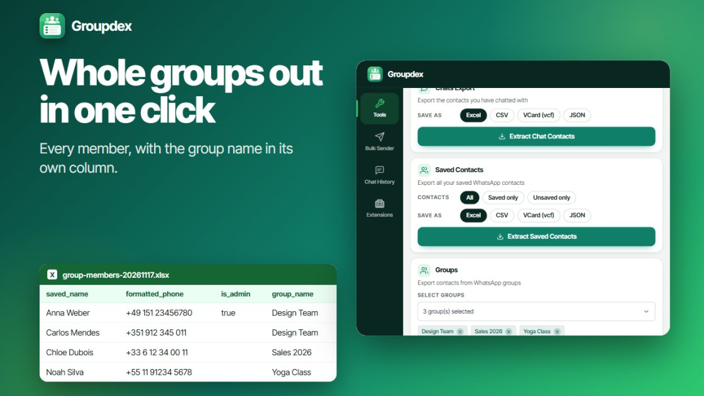
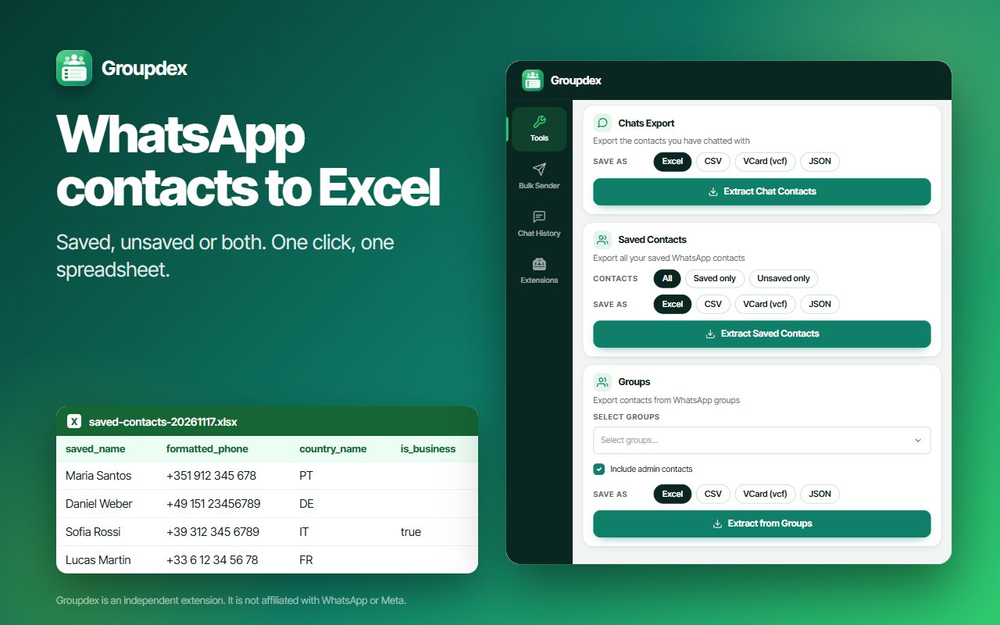
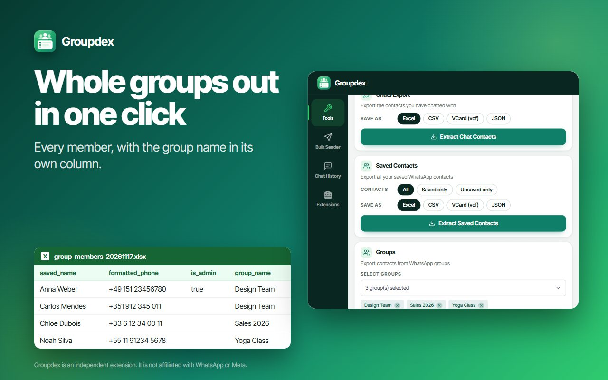
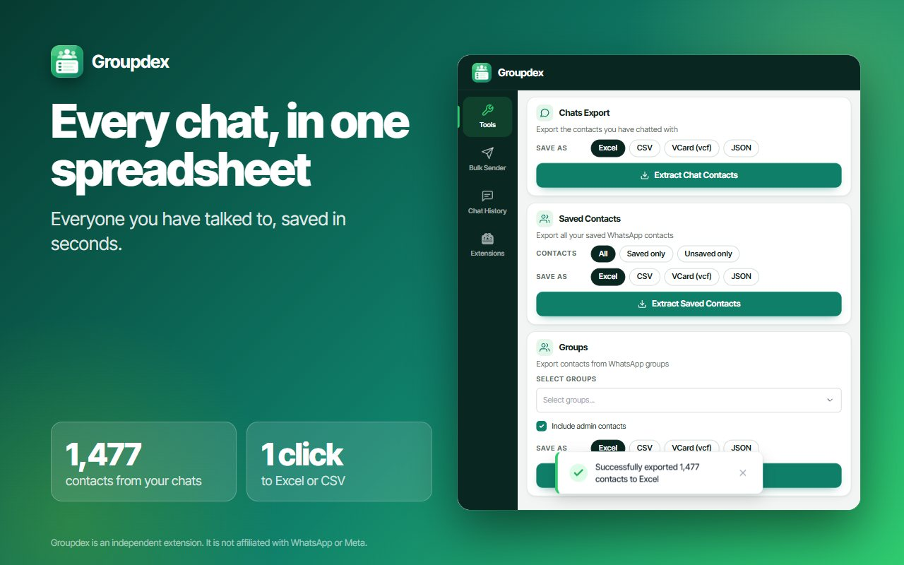
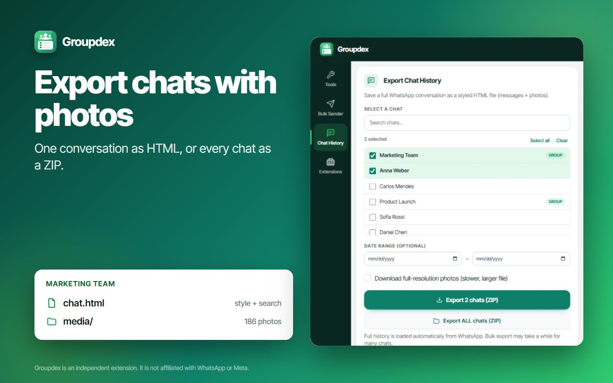
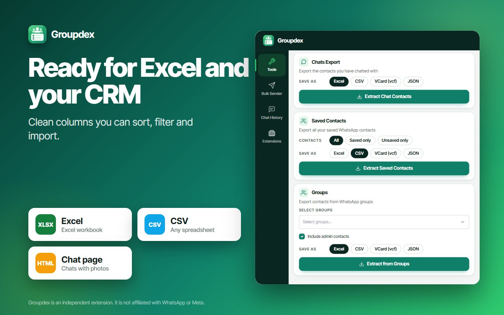

# Groupdex - WhatsApp Group Contacts Exporter to Excel

Groupdex is a Chrome extension for WhatsApp Web that exports group members, chat contacts and saved contacts to Excel, CSV or vCard. Tick the groups you need and get one spreadsheet with names, phone numbers, group names and an admin column. Everything is read in your browser and written straight into the file you download.

<a href="https://chromewebstore.google.com/detail/joikbmkpgnjdaaidcoiamajpnjckodnn?utm_source=github&utm_medium=readme&utm_campaign=groupdex">Chrome Web Store</a> |
<a href="https://www.addonschrome.com/extensions/groupdex-contacts-chat-exporter-for-whatsapp.html?utm_source=github&utm_medium=readme&utm_campaign=groupdex">Full guide and FAQ</a> |
<a href="https://www.youtube.com/watch?v=JoDq_zLs8Gg">Video demo</a>

This repository is the public home for Groupdex's documentation, release notes and issue tracker. The extension itself is distributed through the Chrome Web Store.

## What it exports

- **Group members:** pick one group or many. One row per member, so a person in two groups appears under both.
- **Columns:** saved name (empty for people you never saved), phone number in international format, country, group name, and an admin flag when "Include admin contacts" is on.
- **Unsaved numbers:** members you never saved are exported with their phone number.
- **Chat contacts:** everyone you have a conversation with, in one sheet.
- **Saved contacts:** all of them, saved only, or unsaved only.
- **Chat history:** a conversation as a readable HTML page with its photos, or many chats as a ZIP, with an optional date range.
- **Formats:** Excel (.xlsx, default), CSV for Google Sheets, mailing tools or CRM imports, and vCard for a phone's address book.

## How to use it

1. Open WhatsApp Web on your computer and wait for your chats to load.
2. Click the Groupdex icon in the Chrome toolbar and sign in with your Google account (used only to recognise your account).
3. In the Tools tab, open the Groups card and tick one or more groups. Leave "Include admin contacts" on for the admin column.
4. Choose Excel or CSV and press Extract from Groups. The file is saved to your Downloads folder.

## Privacy

- Contacts, phone numbers and messages are read inside your browser and written into the file you download. They are not sent to the developer's server or anyone else.
- Google sign-in gives the extension your name, email address and profile picture only. No access to Gmail, Drive or Google Contacts.
- Read-only: Groupdex never sends a message, changes a group or deletes anything.

## Responsible use

A member list contains other people's phone numbers. Use the export only for groups you belong to and for purposes the members would expect, follow the privacy laws that apply to you (for example GDPR), and do not use the list to send unsolicited messages.

## Related tools

- Need a chat as PDF or a message-by-message spreadsheet? See [Chatalbum](https://github.com/yasininprofili/chatalbum).

## Screenshots

## Support

Found a bug or have a feature request? [Open an issue](../../issues).

## Disclaimer

Groupdex is an independent extension. It is not affiliated with, endorsed by, or connected to WhatsApp LLC or Meta Platforms, Inc. WhatsApp is a trademark of its owner and is used here only to describe what the extension works with.

---

Built and maintained by [Addons Chrome](https://www.addonschrome.com/?utm_source=github&utm_medium=readme&utm_campaign=groupdex).
